# 🦁 Manestage — Mane's Interview & Presentation Coach

**Manestage** is a soft pastel-orange communication studio (Caslon type, Mane the round pastel lion as your coach) that turns a laptop webcam into a full mock-interview and presentation-rehearsal stage. It measures *how* you speak (pace, pauses, eye contact, posture, pitch) with on-device MediaPipe/Web Speech telemetry, pairs it with *what* you said (transcript + weighted rubric), and returns a structured, evidence-backed scorecard with an interactive quality timeline — in one click.

**Modules:** Presentation Coach (purpose → rubric weightage → deck & hardware calibration → live room → analytics) · Interview Coach (industry raffle wheel → question calibration → live TTS stage → six-dimension report) · Master Analytics (tabbed longitudinal line graphs + skill radar charts).

## Problem Statement

Rehearsing for behavioral interviews and stakeholder presentations is a high-friction workflow:

- **No feedback loop.** Candidates rehearse into a void — they can't tell whether their answer had a clear STAR structure, whether the Result was quantified, or whether they buried the headline answer under a two-minute story.
- **Scattered tooling.** Rubrics live in PDFs, notes live in docs, pacing feedback (if any) comes from slow manual review. Nothing ties spoken delivery telemetry to the written evaluation criteria.
- **Expensive practice.** Real coaching sessions are costly and don't scale to "run it five more times tonight."

**Target audience:** job seekers preparing behavioral/technical interviews, students and professionals rehearsing graded or stakeholder presentations, and career-center / bootcamp cohorts that need repeatable, rubric-aligned practice at scale.

## What It Does (3 clicks or fewer)

1. **Presentation track** — upload a rubric PDF + slides → *Parse* → rehearse on camera → *Evaluate* → point-by-point scorecard with timestamped evidence.
2. **Interview track** — paste a job description/resume → *Generate 5 tailored questions with STAR pointers* → answer on camera → *Evaluate* → 0–100 scorecard across pacing, STAR structure, strategic alignment, and directness.
3. **Analytics** — every session is stored locally and rolls up into trend charts (scores over time, flagged behaviors).

## Architecture

```mermaid
flowchart TD
    subgraph Client["Next.js 16 App Router (React 19, Tailwind 4)"]
        UI["Dashboard: /presentation, /interview, /analytics"]
        Cam["CameraFeed + useTelemetry<br/>MediaPipe: posture, gaze, pitch, pace"]
        Up["RubricUploader<br/>pdfjs-dist · jszip (pptx) · PDF/PPTX/text"]
    end

    subgraph API["Route Handlers (Node runtime, server-side keys)"]
        R1["POST /api/presentation/parse-rubric"]
        R2["POST /api/presentation/evaluate"]
        R3["POST /api/interview/generate-questions"]
        R4["POST /api/score"]
    end

    subgraph Core["Orchestration layer (src/lib)"]
        G["gemini.ts<br/>getGeminiClient · generateWithRetry (exp. backoff)"]
        S["Structured output: responseSchema"]
        P["presentation.ts · interview.ts<br/>prompt builders, char budgets, trimming"]
        OFF["offline-engine.ts<br/>deterministic fallback when API unavailable"]
        H["session-history.ts (localStorage)"]
    end

    UI --> Up --> R1
    UI --> Cam --> R2
    Cam --> R4
    UI --> R3
    R1 & R2 & R3 & R4 --> G
    G -->|retry on 429/503| Gemini[("Gemini Flash")]
    G -->|no key / quota| OFF
    R1 & R2 & R3 & R4 --> S
    R1 & R2 & R3 & R4 --> P
    UI --> H --> Analytics["/analytics trends"]
```



**Technical flow (evaluation request):**

1. Client validates input size, captures transcript + telemetry session summary (raw events stripped to a compact summary for the prompt).
2. Route handler re-validates (length caps, required fields) → assembles a prompt with explicit char budgets (`trimForPrompt`).
3. `generateWithRetry` calls Gemini with a **strict response schema** (`application/json` + `responseSchema`) and **exponential backoff** on 429/503/overload.
4. Response is parsed and structurally validated before reaching the UI; failures return friendly `{ error }` messages with proper HTTP status — never raw API errors.
5. If Gemini is unavailable (no key / hard quota), the **offline engine** produces a deterministic local scorecard so the UI degrades gracefully instead of breaking.

## Hackathon Rules Mapping

- **Orchestration, not a wrapper:** multi-step agent workflows (parse rubric → evaluate), structured output schemas for every LLM response (`SCORECARD_SCHEMA`, `PARSE_SCHEMA`, `GENERATE_QUESTIONS_SCHEMA`, plus the Zod feedback schemas), and local state manipulation (session history, telemetry capture).
- **Dynamic context handling:** all prompts pass through `trimForPrompt` with per-input budgets (`MAX_RUBRIC_CHARS`, `MAX_SLIDE_CHARS`, `MAX_TRANSCRIPT_CHARS`).
- **Reliability:** `generateWithRetry` (4 attempts, 800 ms exponential backoff, skips daily-quota lockouts), offline fallback engine, friendly UI error states.
- **Safety:** API key read only in server route handlers; model output is schema-constrained JSON, re-validated before rendering; users see normalized errors, not stack traces.
- **Demo logging:** every agent step is logged with an `[agent:<step>]` prefix in the server console (see below), so demo recordings can be narrated straight from the terminal.

## Setup

### Prerequisites

- Node.js 20+
- A Gemini API key — create one free at [Google AI Studio](https://aistudio.google.com/apikey) (open the link, sign in, and click **Create API key**)

### Install & run

```bash
git clone <your-repo-url> manestage
cd manestage
npm install

cp .env.example .env.local
# open .env.local and paste your Gemini API key — never paste it in chat
# and never commit it (.env* files are gitignored; only .env.example is tracked)

npm run dev
```

Open [http://localhost:3000](http://localhost:3000).

> **Restart after editing `.env.local`.** Next.js only reads env files at
> startup — changes don't take effect until you stop and re-run `npm run dev`.

### Environment variables

Create `.env.local` from `.env.example` and fill in:

| Variable | Where it's used | Required |
| --- | --- | --- |
| `GEMINI_API_KEY` | Server routes only (`src/app/api/*`) — no `NEXT_PUBLIC_` prefix, so it is never bundled into the browser | ✅ for AI features |
| `GEMINI_MODEL` | Model for every AI route (`/api/score`, `/api/presentation/*`, `/api/interview/generate-questions`); defaults to `gemini-3.7-flash` when unset | ⛔ optional |

The app builds and runs without any key; API routes return a friendly error and the offline engine keeps the core flow usable.

### LLM scorer (`POST /api/score`)

Browser code never imports the Gemini SDK and never reads the key — it only
calls `POST /api/score` via the typed helper in `src/lib/score-client.ts`
(the SDK is imported exclusively by the server route handlers under
`src/app/api/*`). The route
validates the body with Zod, short-circuits very short transcripts with an
`insufficient_data` result before any model call (`shouldScore`), parses the
model's JSON with a Zod schema (retrying once on failure), and drops any
score whose `evidenceQuote` is not a verbatim quote from the transcript
(`validate`).

## Demo Logging

Server console output is prefixed so each agent step is easy to follow while screen-recording:

```
[agent:gemini] retry attempt=2/4 delayMs=800 reason="503 Service Unavailable ..."
[agent:interview-evaluate] step=received transcriptChars=1482 companyNewsChars=0 telemetry=ok
[agent:interview-evaluate] step=calling-gemini model=gemini-3.7-flash promptChars=6211
[agent:interview-evaluate] step=scorecard-generated overallScore=78 engine=gemini
```

Run `npm run dev` in a terminal next to the browser to capture these alongside the UI.

## Scripts

```bash
npm run dev    # development server
npm run build  # production build (verified passing)
npm run lint   # eslint
npm run start  # serve production build
```

## Deployment

Deployable as-is to Vercel (or any Node host — Render/Fly.io):

```bash
npm i -g vercel && vercel
# then set GEMINI_API_KEY in the project's Environment Variables
```

🔗 **Live deployment:** _&lt;paste your Vercel/Render URL here after deploying&gt;_

Env vars are read from `.env.local` in dev and from the host's environment settings in production — no code changes required per platform.

## Tech Stack

Next.js 16 (App Router) · React 19 · TypeScript · Tailwind CSS 4 · @google/genai (LLM scorer) · zod · @google/generative-ai · @mediapipe/tasks-vision · pdfjs-dist · jszip · framer-motion · shadcn/ui