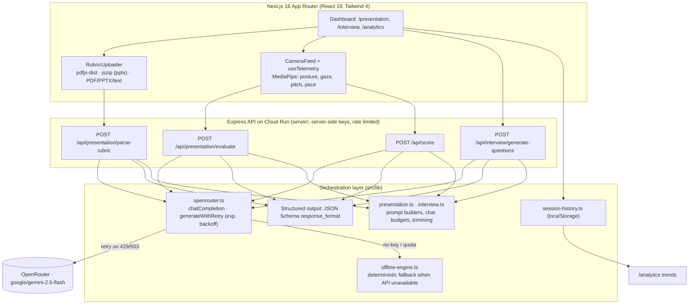

# 🦁 Manestage — Mane's Interview & Presentation Coach

**Manestage** is a soft pastel-orange communication studio (Caslon type, Mane the round pastel lion as your coach) that turns a laptop webcam into a full mock-interview and presentation-rehearsal stage. It measures *how* you speak (pace, pauses, eye contact, posture, pitch) with on-device MediaPipe/Web Speech telemetry, pairs it with *what* you said (transcript + weighted rubric), and returns a structured, evidence-backed scorecard with an interactive quality timeline — in one click.

**Modules:** Presentation Coach (purpose → rubric weightage → deck & hardware calibration → live room → analytics) · Interview Coach (industry raffle wheel → question calibration → live TTS stage → six-dimension report) · Master Analytics (tabbed longitudinal line graphs + skill radar charts).

## Problem Statement

Rehearsing for behavioral interviews and stakeholder presentations is a high-friction workflow:

- **No feedback loop.** Candidates rehearse into a void — they can't tell whether their answer had a clear STAR structure, whether the Result was quantified, or whether they buried the headline answer under a two-minute story.
- **Scattered tooling.** Rubrics live in PDFs, notes live in docs, pacing feedback (if any) comes from slow manual review. Nothing ties spoken delivery telemetry to the written evaluation criteria.
- **Expensive practice.** Real coaching sessions are costly and don't scale to "run it five more times tonight."

**Target audience:** job seekers preparing behavioral/technical interviews, students and professionals rehearsing graded or stakeholder presentations, and career-center / bootcamp cohorts that need repeatable, rubric-aligned practice at scale.

## What It Does (3 clicks or fewer)

1. **Presentation track** — upload a rubric PDF + slides → *Parse* → rehearse on camera → *Evaluate* → point-by-point scorecard with timestamped evidence.
2. **Interview track** — paste a job description/resume → *Generate 5 tailored questions with STAR pointers* → answer on camera → *Evaluate* → 0–100 scorecard across pacing, STAR structure, strategic alignment, and directness.
3. **Analytics** — every session is stored locally and rolls up into trend charts (scores over time, flagged behaviors).

## Architecture



**Technical flow (evaluation request):**

1. Client validates input size, captures transcript + telemetry session summary (raw events stripped to a compact summary for the prompt).
2. The API route re-validates (length caps, required fields) → assembles a prompt with explicit char budgets (`trimForPrompt`).
3. `generateWithRetry` calls OpenRouter with a **strict JSON Schema** (`response_format: json_schema`) and **exponential backoff** on 429/503/overload.
4. Response is parsed and structurally validated before reaching the UI; failures return friendly `{ error }` messages with proper HTTP status — never raw API errors.
5. If the API is unavailable (or the demo limit is reached) (no key / hard quota), the **offline engine** produces a deterministic local scorecard so the UI degrades gracefully instead of breaking.

## Hackathon Rules Mapping

- **Orchestration, not a wrapper:** multi-step agent workflows (parse rubric → evaluate), structured output schemas for every LLM response (`SCORECARD_SCHEMA`, `PARSE_SCHEMA`, `GENERATE_QUESTIONS_SCHEMA`, plus the Zod feedback schemas), and local state manipulation (session history, telemetry capture).
- **Dynamic context handling:** all prompts pass through `trimForPrompt` with per-input budgets (`MAX_RUBRIC_CHARS`, `MAX_SLIDE_CHARS`, `MAX_TRANSCRIPT_CHARS`).
- **Reliability:** `generateWithRetry` (4 attempts, 800 ms exponential backoff, skips daily-quota lockouts), offline fallback engine, friendly UI error states.
- **Safety:** API key read only by the Express API; model output is schema-constrained JSON, re-validated before rendering; users see normalized errors, not stack traces.
- **Demo logging:** every agent step is logged with an `[agent:<step>]` prefix in the server console (see below), so demo recordings can be narrated straight from the terminal.

## Setup

### Prerequisites

- Node.js 22+
- An OpenRouter API key from [openrouter.ai/keys](https://openrouter.ai/keys)

### Install & run

```bash
npm install
cp .env.example .env      # fill in API_KEY; never commit .env

npm run dev:server        # API on http://localhost:8080 (tsx watch)
npm run dev               # frontend on http://localhost:3000
```

The frontend calls the API at `NEXT_PUBLIC_API_BASE`, which defaults to
`http://localhost:8080` when unset. Without Upstash credentials rate limiting is
disabled, which is what local dev wants.

### Layout

| Part | Where | Hosting |
| --- | --- | --- |
| Frontend (Next.js, MediaPipe + Web Speech in the browser) | `src/app`, `src/components`, `src/hooks` | Vercel |
| API (Express 5, the four AI routes + `GET /api/health`) | `server/` (imports `src/lib`) | Cloud Run |

Every browser call goes through `src/lib/api.ts`. A 429 from the rate limiter opens the
AI Lodge CTA modal, a 503 shows a "demo temporarily paused" notice, and the offline
coach still produces a local result in both cases.

### Environment variables

API (`.env` locally, the `DOTENV` secret in production; see `.env.example`):

| Variable | Purpose |
| --- | --- |
| `API_KEY` | OpenRouter key (required for AI features) |
| `MODEL_NAME` | Model for every route, default `google/gemini-2.5-flash` (must accept PDFs) |
| `CORS_ORIGINS` | Comma-separated frontend origins (the Vercel URL) |
| `UPSTASH_REDIS_REST_URL` / `UPSTASH_REDIS_REST_TOKEN` | Shared rate-limit store |
| `RATE_LIMIT_SCORE_MAX`, `RATE_LIMIT_GENERATE_QUESTIONS_MAX`, `RATE_LIMIT_EVALUATE_MAX`, `RATE_LIMIT_PARSE_RUBRIC_MAX` | Per-IP fallback limits |
| `RATE_LIMIT_WINDOW_SECONDS` | Window, default 432000 (5 days) |

Frontend (Vercel): `NEXT_PUBLIC_API_BASE` = the Cloud Run URL.

### LLM scorer (`POST /api/score`)

Browser code never reads the key: it calls `POST /api/score` via the typed helper in
`src/lib/score-client.ts`. The route validates the body with Zod, short-circuits very
short transcripts with an `insufficient_data` result before any model call
(`shouldScore`), parses the model's JSON with a Zod schema (retrying once on failure),
and drops any score whose `evidenceQuote` is not a verbatim quote from the transcript
(`validate`).

## Demo Logging

Server console output is prefixed so each agent step is easy to follow while screen-recording:

```
[agent:llm] retry attempt=2/4 delayMs=800 reason="503 Service Unavailable ..."
[agent:interview-evaluate] step=received transcriptChars=1482 companyNewsChars=0 telemetry=ok
[agent:interview-evaluate] step=calling-llm model=google/gemini-2.5-flash promptChars=6211
[agent:interview-evaluate] step=scorecard-generated overallScore=78 engine=gemini
```

Run `npm run dev:server` in a terminal next to the browser to capture these alongside the UI.

## Scripts

```bash
npm run dev           # frontend dev server
npm run dev:server    # API dev server (tsx watch, reads .env)
npm run build         # frontend production build
npm run build:server  # bundle the API into server/dist/server.js (esbuild)
npm run start:server  # run the bundled API
npm test              # vitest
```

## Deployment

- **API → Cloud Run:** `.github/workflows/deploy.yml` builds the root `Dockerfile`, pushes
  it to Docker Hub and deploys service `ail-ay2627-s1-dhee-pitch-perfect` on every push
  to `main`. Env vars come from the `DOTENV` repo secret
  (`gh secret set DOTENV --repo smubia-projects/ail-ay2627-s1-dhee-pitch-perfect < .env`).
- **Frontend → Vercel:** import the repo (root directory = repo root, Next.js preset),
  set `NEXT_PUBLIC_API_BASE` to the Cloud Run URL, then add the Vercel URL to
  `CORS_ORIGINS` and redeploy the API.

## Tech Stack

Next.js 16 (App Router) · React 19 · TypeScript · Tailwind CSS 4 · Express 5 (Cloud Run API) · OpenRouter · zod · @upstash/redis (rate limiting) · @mediapipe/tasks-vision · pdfjs-dist · jszip · framer-motion · shadcn/ui
